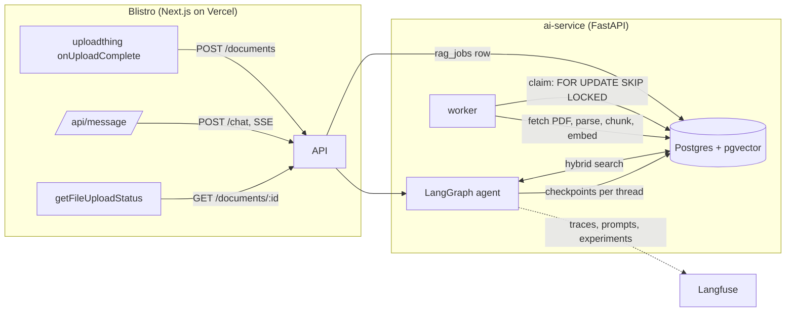
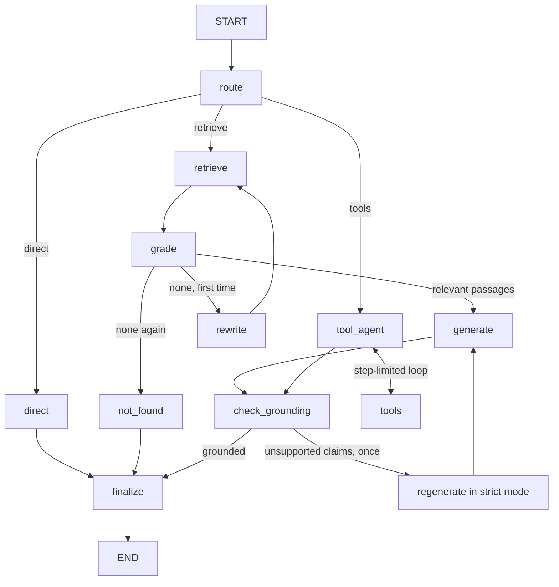

# Blistro AI service: agentic RAG over your PDFs

A Python service that replaces Blistro's original single-call RAG (Pinecone top-4
and one prompt) with a LangGraph agent. It decides how to answer, checks that what
it retrieved is relevant, uses tools for whole-document work, verifies its answer
against the sources and cites pages. The Next.js app calls it when
`AI_SERVICE_URL` is set and keeps the old pipeline otherwise.

## Architecture



### The agent graph



- **route**: structured output picks `retrieve`, `tools` or `direct`, and rewrites
  follow-up questions as standalone questions using the conversation.
- **grade**: an LLM marks which retrieved passages actually answer the question.
  If none do, the query is rewritten once; then the agent says it couldn't find it
  rather than guess.
- **tools**: `search_documents`, `get_page`, `summarize_document` (map-reduce),
  `compare_documents`, `calculator` (AST-based, no `eval`). User and document scope
  are injected from the run config and hidden from the model, so it can't search
  someone else's documents by naming them.
- **check_grounding**: a judge lists claims the context doesn't support. One
  strict regeneration is allowed, then a safe fallback answer.
- **finalize**: maps `[S2]` labels to `[p. 14]` (or `[Report.pdf, p. 14]` across
  documents) and returns the sources.
- **Memory**: conversation state is checkpointed in Postgres (`AsyncPostgresSaver`)
  per user and file; per-turn working state is reset each turn.
- **Guardrails**: recursion limit, tool-step limit, LLM and tool timeouts,
  per-user rate limit.

### Retrieval

- **Chunking**, three strategies compared in the evals:
  - `fixed`: token windows with overlap.
  - `recursive`: splits on headings detected from font size, then on paragraphs,
    then on sentences. It keeps the heading with every chunk.
  - `semantic`: breaks where the embedding distance between sentences jumps.

  Every chunk keeps its page range.
- **Hybrid search** in Postgres:
  - pgvector HNSW cosine search, with iterative scans so filtered queries still
    return k rows.
  - Postgres full-text search (`ts_rank_cd`). It is not BM25, but it catches the
    exact codes, names and numbers that embeddings blur.
  - The two lists are fused with reciprocal rank fusion (k=60).
- **Reranking** (optional): Cohere `rerank-v5.0-fast` or a local
  `BAAI/bge-reranker-v2-m3` cross-encoder.

### Ingestion

- `POST /documents` returns `202` right away and writes a `rag_jobs` row.
- A separate worker process claims jobs with `FOR UPDATE SKIP LOCKED`.
- Retries are bounded, and permanent errors (not a PDF, too large) are not retried.
- A job is reclaimed if its worker dies.
- Ingestion doesn't run in FastAPI `BackgroundTasks`, so a deploy or restart
  can't lose an upload.

### Security

- **Auth:**
  - The Next.js server, which has already authenticated the user with Kinde,
    calls with a shared `SERVICE_TOKEN` (compared in constant time) and `X-User-Id`.
  - Clients can instead send a Kinde access token, verified against Kinde's JWKS.
  - `AUTH_MODE=dev` refuses to start with `ENV=production`.
- **Isolation:**
  - Every SQL query filters on the user id from auth, never from the request body
    or the model.
  - Thread ids are namespaced by user.
  - Registering a document id that another user owns returns 403. It can't
    hijack that document.
- **SSRF:** the worker fetches PDFs only over https from an allowlist
  (uploadthing's CDNs), with no redirects, a size cap and a `%PDF` check.

## Run it locally

```bash
cp .env.example .env          # add OPENAI_API_KEY
docker compose up -d db
uv sync --extra local-rerank  # drop the extra if you don't want the local reranker
make test
make api                      # http://localhost:8000/docs
make worker                   # in another terminal
```

Or run everything in containers: `docker compose up --build`.

Try it with dev auth:

```bash
curl -N localhost:8000/chat -H 'X-Dev-User: me' -H 'Content-Type: application/json' \
  -d '{"document_ids":["eval-p15"],"message":"When are Form 941 deposits due?"}'
```

### Connect Blistro

Set these in the Next.js app (Vercel env):

```
AI_SERVICE_URL=https://<your-service-host>
AI_SERVICE_TOKEN=<same value as SERVICE_TOKEN in the service>
```

The service needs `ENV=production`, `AUTH_MODE=kinde`, `KINDE_ISSUER_URL`,
`SERVICE_TOKEN`, `DATABASE_URL` (Neon works; set `DB_POOLED=true` with its pooler),
`OPENAI_API_KEY`, and optionally the Langfuse and Cohere keys. Deploy the image
twice: once as the API and once as the worker (`python -m app.worker`).

## Evals

```bash
./evals/corpus/fetch.sh   # 7 public-domain NIST and IRS PDFs, ~360 pages
make corpus               # ingest with all three chunking strategies
make dataset              # LLM-written questions, each checked against its page
make eval                 # retrieval matrix + end-to-end agent, report in evals/results/
```

- **Dataset:** for each question, the supporting quote must appear verbatim on its
  gold page, or the question is dropped. A quarter of the questions are held out
  (`--split test`) and not used for tuning.
- **Retrieval metrics:** recall@5, MRR@5 and doc recall@5 for every
  strategy × mode (vector, full-text, hybrid) × reranker combination, plus search
  latency.
- **End-to-end metrics:**
  - judge correctness against the reference answer;
  - faithfulness (the share of answer claims supported by the retrieved context);
  - citation accuracy (a cited page is the gold page; computed, not judged);
  - the "not found" rate;
  - time to first token, p50 and p95.
- **Langfuse:** with keys set, `--langfuse` logs the run as a Langfuse
  experiment, so runs can be compared in the UI.
- **CI:** runs lint and tests (with a pgvector service) on every change. On pull
  requests it also runs a 15-question smoke eval when the `OPENAI_API_KEY` secret
  is set.

Results: see `evals/results/` (written by `make eval`).

## Prompts and tracing

- **Prompts:** they live in `app/agent/prompts.py`.
  - `python -m scripts.push_prompts` uploads them to Langfuse with the `staging`
    label.
  - The service reads the `production` label, so a prompt change goes live only
    when you promote it.
  - It falls back to the local copy if Langfuse is unreachable.
- **Tracing:** with Langfuse keys set, every chat run is traced: each node, LLM
  call and tool call, with the user and thread as session.

## Layout

```
app/
  api.py            FastAPI: /documents, /jobs, /chat (SSE), /health
  worker.py         ingestion worker
  auth.py           service token / Kinde JWT / dev auth, rate limit
  retrieval.py      vector + full-text + RRF + rerank, all scoped by user
  ingest/           PDF parsing (PyMuPDF), chunkers, job queue
  agent/            graph, tools, prompts
  observability.py  Langfuse callbacks and prompt fetching
evals/              dataset builder, eval runner, corpus sources, results
scripts/            local ingest, prompt upload
tests/              unit + Postgres integration tests
```
